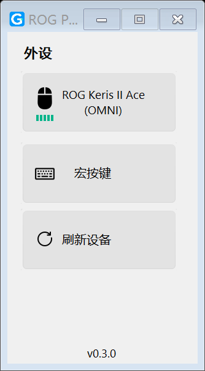
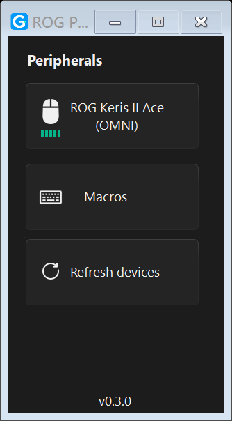
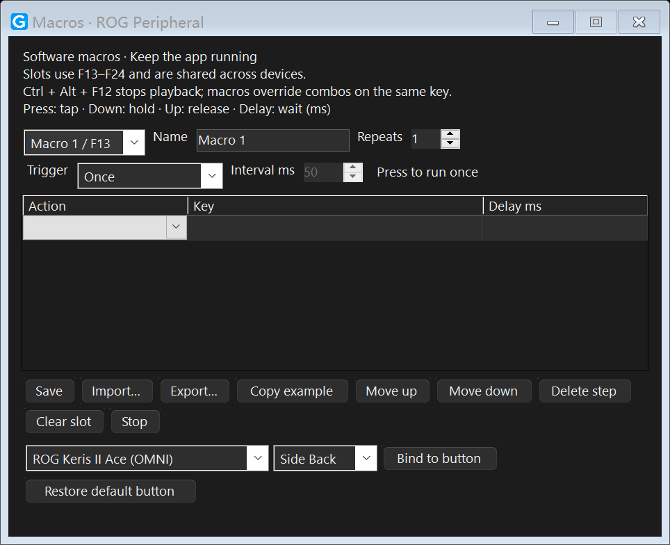

<p align="center"></p>

# ROG Peripheral Lite

基于 [G-Helper](https://github.com/seerge/g-helper) 的独立 Windows ROG 外设设置工具，保留原版轻量界面，增加软件宏、宏导入导出与触发方式设置。

**v0.3.0 · Windows x64 · .NET 8 · GPL-3.0**

本项目是社区修改版，与 ASUS 或 G-Helper 原作者不存在官方隶属或背书关系。仅保留外设功能，不包含笔记本风扇、功耗、显卡模式、电池充电限制或驱动更新。

An independent Windows peripheral utility derived from G-Helper, with software macros and JSON/CSV/AutoHotkey import/export. New pages support English, Simplified Chinese and Traditional Chinese; device pages retain upstream translations.

## 界面预览

<p>
  
  
</p>

<details>
<summary>宏编辑器预览</summary>



</details>

## 功能

- 沿用上游鼠标、键盘、耳机的识别与设置模块；功能取决于型号、固件和连接方式。
- 鼠标 DPI、回报率、灯效、配置档与按键映射等设置，以设备实际支持为准。
- 12 个软件宏槽位：点按、按下、松开、延迟，以及三种触发方式。
- JSON、CSV 步骤表、AutoHotkey v1/v2 按键与延迟子集的导入导出。
- 固定窗口尺寸、竖排卡片、浅色/深色跟随、多语言和托盘常驻。

## 获取与运行

可用的正式发布包见 [Releases](https://github.com/astraeakoa/rog-peripheral-lite/releases)。尚无发布包时，可按下方步骤自行构建；**Code → Download ZIP** 下载的是源码。

1. 解压程序包到可写目录，运行 `ROGPeripheral.exe`。
2. 通过 USB 数据线或接收器连接外设，点击设备卡片进入设置。
3. 关闭窗口会隐藏到托盘；彻底退出请右键托盘图标选择“退出”。

自包含发布包无需额外安装 .NET。请避免与 G-Helper、Armoury Crate 同时配置同一设备。配置和日志保存在 `%APPDATA%/ROGPeripheral`，不会读取或覆盖原版 G-Helper 配置。

### 设备支持与验证范围

设备实现来自上游[鼠标](src/Peripherals/Mouse)、[键盘](src/Peripherals/Keyboard)和[耳机](src/Peripherals/Headset)模块，保留支持不等于每种设备均已实测。

当前验证主要围绕 **ROG Keris II Ace（月刃 II ACE）**：已有有线识别、设置读取、按键映射读取记录，以及 OMNI 连接下的界面验证。自动测试检查绑定报文和错误处理；物理侧键触发及写入后行为仍需在目标设备上确认。上游设备列表不代表本项目全型号兼容保证。

## 软件宏

1. 点击“宏按键”，选择槽位、填写名称并设置触发方式。
2. 添加步骤：`Press` 点按、`Down` 按下、`Up` 松开、`Delay` 延迟（毫秒）。按键示例：`A`、`Enter`、`Space`、`LControlKey`。
3. “复制示例”可生成 Ctrl+C；也可导入文件，检查后点击“保存”。
4. 选择鼠标与侧键，点击“绑定到此按键”，写入当前鼠标配置档。
5. 在目标窗口测试；`Ctrl + Alt + F12` 或托盘“停止宏”可中止执行。
6. 撤销绑定使用“恢复默认按键”；清除宏槽位不会自动恢复鼠标映射。

| 触发方式 | 行为 |
| --- | --- |
| 单次按下 | 按下执行一轮，轮内按“每轮次数”重复 |
| 连续触发 | 按下后循环，再次按下停止 |
| 按住触发 | 按住时循环，松开立即停止 |

**宏需要程序保持运行。** 多步骤保存在电脑，鼠标内仅写入 F13–F24 触发映射，不能脱离程序运行整段宏。槽位由设备共用，宏优先于同键的原版组合键。新增宏绑定界面针对鼠标，键盘沿用上游映射。

每个宏最多 500 步，每轮重复 1–100 次，单次延迟 1–60000 毫秒，一轮含重复的总延迟最多 10 分钟；连续/按住模式可循环至停止。同一时刻只执行一个宏，不排队。编辑内容需要手动保存。

不支持鼠标轨迹录制。AHK 仅解析受支持的数据子集，不执行脚本，不支持循环、函数、表达式或完整 AHK 功能；不支持厂商专有宏文件。详见[宏格式说明](docs/MACRO_FORMATS.md)和[示例](examples)。权限更高的程序及部分游戏可能不接受模拟输入。

## 主题与语言

默认跟随 Windows 应用颜色和界面语言。系统主题变化时刷新已打开窗口和托盘菜单，保留宏编辑内容。

如需覆盖默认值，先退出程序，编辑 `%APPDATA%/ROGPeripheral/config.json`，**合并以下字段并保留已有配置，不要覆盖整个文件**：

```json
{
  "ui_mode": "dark",
  "language": "zh-CN"
}
```

| 字段 | 可选值 |
| --- | --- |
| `ui_mode` | `light` 浅色；`dark` 深色；`windows` 使用原版 Windows 主题接口；省略或空字符串则读取 Windows 应用颜色设置 |
| `language` | `zh-CN` 简体；`zh-TW` 繁体；`en` 英语；或上游其他语言代码；省略或空字符串则跟随系统 |

手动修改后重启生效。外设页保留上游翻译；新增页面及宏提示提供中简、中繁和英文，其他语言缺失译文时回退英文。用户填写的宏名称及按键代码不被翻译。

## 从源码构建

需要 Windows、Git 和 **.NET 8 SDK**。

```powershell
git clone https://github.com/astraeakoa/rog-peripheral-lite.git
cd rog-peripheral-lite
dotnet build src/ROGPeripheral.csproj
dotnet run --project tests/ROGPeripheral.Tests.csproj -c Release
./build.ps1
```

脚本先运行测试，再生成自包含的 `dist/ROGPeripheral.exe` 和 `ROGPeripheral-win-x64.zip`。旧程序占用输出时先退出，或指定 `./build.ps1 -OutputDir dist-new`。依赖由 NuGet 还原，无需克隆上游仓库。

GitHub Actions 在 Windows 上执行构建，并提供程序与对应源码产物；不会自动创建正式 Release。发布二进制时，应附上该提交的对应源码、许可证和第三方声明。

### 项目结构

```text
src/                   WinForms、外设协议与宏实现
src/Properties/        上游和新增翻译资源
tests/                 自动检查（不注入真实输入、不写真实 HID）
assets/                图标原图及 ICO 构建脚本
examples/              JSON / CSV / AHK 宏示例
docs/                  格式说明、更新记录、截图
licenses/              依赖许可证与通知
build.ps1              测试、发布与打包
```

自动检查覆盖宏校验、执行、停止与释放、触发边沿、格式往返、绑定报文及翻译回退。界面检查覆盖中简浅色、英文深色、中繁深色和切换主题时保留编辑内容。

- `--diagnose`：只枚举 ASUS HID VID/PID，写入程序目录的 `devices.json`。
- `--ui-smoke`：读取设备设置并渲染窗口，在程序目录生成 `ui-smoke/` 后退出，不注册全局宏监听。
- 测试可设置 `ROG_PERIPHERAL_CONFIG_DIR` 指向独立目录，避免使用日常配置。

## 反馈问题

请在 [Issues](https://github.com/astraeakoa/rog-peripheral-lite/issues) 提供版本、Windows 版本、设备型号、固件、连接方式及复现步骤。日志上传前请移除个人信息，不要上传自己的完整宏配置。

## 来源与许可

基于 [seerge/g-helper](https://github.com/seerge/g-helper)，起始提交 [`af7e1c0`](https://github.com/seerge/g-helper/commit/af7e1c002b1597269d8a977f2464fdab4f5d9fe6)，保留上游历史与版权归属。

修改日期：**2026-10-21**。修改包括独立外设程序、移除笔记本模块、新增软件宏和导入导出、固定竖排布局、新图标及主题/多语言适配。见[更新记录](docs/CHANGELOG.md)。

整体按 [GNU GPL v3](LICENSE) 发布。允许在遵守许可证的前提下使用、修改和再分发；分发修改版或二进制须遵守对应源码、版权及许可要求。本软件不提供保证。

感谢 seerge、IceStormNG、G-Helper 贡献者及通信代码署名的 vddCore/Starlight。继承图标资源包括 [Icons8](https://icons8.com) 资产。新应用图标为本项目生成的设计，源图位于 `assets/`。详见 [THIRD_PARTY_NOTICES.md](THIRD_PARTY_NOTICES.md)。ASUS、ROG、TUF 和 Armoury Crate 是各自权利人的商标。
